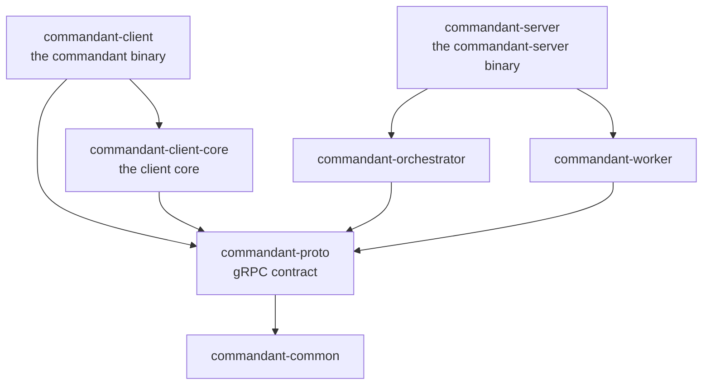

# Code layout

Seven crates, building two binaries: `commandant-server` (server and worker)
and `commandant` (the client). For how they work together at runtime, see
[architecture.md](architecture.md).

The server and the worker are libraries, so `commandant-server` and the
end-to-end tests both run them in-process. The client depends on neither: no
SQLite or libgit2 in `commandant`. The client core has no terminal or window
code, so every front end shares it. Code used by several crates goes in
`commandant-proto` (anything gRPC) or `commandant-common` (everything else).

## `commandant-common`

| File | |
|---|---|
| `lib.rs` | `DEFAULT_PORT`, `VERSION`, `or`, `random_hex` for ids and secrets |
| `link.rs` | The `commandant://` link: encoding, parsing, addresses, the pin of the server's certificate, loopback for the local machine |
| `harness.rs` | `HarnessKind`: the coding agents a worker can host, by name and description |
| `fs.rs` | Private (0600) files, written atomically; reading optional and single-value files; deleting a file or directory |
| `dirs.rs` | Default data, state and config directories |
| `lookup.rs` | Finding a node by name, id or id prefix, and a task by id or id prefix |
| `time.rs` | Unix time, and `12s ago` for tables |

## `commandant-proto`

| File | |
|---|---|
| `proto/commandant.proto` | The contract: `NodeLink` (worker ⇄ server) and `Control` (client → server) |
| `src/lib.rs` | Generated types, `.into()` for message envelopes, the `Reply` trait for answers to questions, and connecting (`channel` tries every address of a link) |
| `src/tls.rs` | TLS to the server a link pins: only its certificate is accepted |

`protoc` is vendored: editing the `.proto` only needs a rebuild.

## `commandant-orchestrator`

| File | |
|---|---|
| `lib.rs` | Opens the data directory, sets up the admin token, serves both services over TLS |
| `tls.rs` | The server's self-signed certificate, made once and kept in the database |
| `link.rs` | `NodeLink`: admits workers (join or reconnect) and handles their messages |
| `control.rs` | `Control`: the admin API; sends tasks and questions to workers |
| `registry.rs` | Which node is connected, on which connection, with which harnesses |
| `tasks.rs` | Fans live task output out to watching clients, keeping its tail |
| `output.rs` | The last 1 MiB of a task's output, chunks tagged with their stream |
| `queries.rs` | Matches workers' answers to the questions asked, by request id and the connection asked |
| `store.rs` | SQLite: tokens, nodes, tasks and their output (migrations in `migrations/`) |
| `auth.rs` | Token generation, hashing, constant-time checks |

## `commandant-worker`

| File | |
|---|---|
| `lib.rs` | Connects and reconnects, then runs tasks and answers questions |
| `state.rs` | `node.json` (credentials), and the state-directory lock |
| `exec.rs` | Runs a command in its own process group and streams its output |
| `process.rs` | Signals a child's whole process group |
| `project.rs` | Clones and lists projects and their copies (git2) |
| `harness.rs` | The `Harness` trait, the `Host` of the running harness, and what harnesses share (session lock, installer, output writer) |
| `opencode/` | OpenCode: the server process (`mod.rs`), its HTTP API (`api.rs`), prompts (`prompt.rs`), options, sessions and sign-in |
| `claude/` | Claude Code: the CLI (`mod.rs`), one prompt's stream (`stream.rs`), sessions from its transcripts (`sessions.rs`) |

## `commandant-server`

| File | |
|---|---|
| `main.rs`, `cli.rs` | Logging, and the command line (clap) |
| `serve.rs`, `worker.rs` | `serve` (link, reset, local worker) and `worker` |
| `tests/e2e.rs` | End-to-end tests with a real server and workers in-process, and a real client core against them |
| `tests/fake_opencode/` | A fake OpenCode the tests drive (`hold`, `fail`, `permission` in a prompt) |

## `commandant-client`

| File | |
|---|---|
| `main.rs`, `cli.rs` | Logging, the tokio runtime, and the command line (clap); a bare `commandant` prints help in a terminal and opens the GUI elsewhere |
| `admin.rs`, `run.rs` | `login`, `token`, `node`, `task`; `run`, `prompt` and `task watch`: plain gRPC calls |
| `start.rs` | What `tui` and `gui` give the core: new chats' defaults, and the chat `--node` and `--session` open first |
| `tui/mod.rs` | The TUI's event loop: draws, reads keys, hands the core's updates back to it |
| `tui/app.rs` | The screen shown (nodes, a chat, the tasks or a task's output) and where Esc goes back to, the highlighted node and task, the last chat per node, the app's own line (`r` on the nodes); routes keys to intents |
| `tui/chat.rs` | A chat's prompt (editing, history recall, completion highlight) and scroll |
| `tui/ui/`, `tui/text.rs` | Drawing (`tasks.rs`: the task list, and an output filling the screen), and markdown styling |
| `tui/asks.rs`, `tui/picker.rs` | What keys say to an ask: the floating list, narrowed down by typing, for a choose-ask, a panel for a confirm- or show-ask; a chat's enter-ask is typed in its prompt, the app's in a box of its own. The app's and each chat's picker are shown from one map |
| `tui/help.rs` | The help (F1, `?` on the nodes, `/help`): every command, `!` to run one on the node, the agent's commands and skills, and the terminal's keys in one such list, searched by name, key, alias or what it does; choosing one runs it, starts it in the prompt, or presses the key |
| `gui/mod.rs` | The GUI (the `gui` feature, off by default): GPUI on the main thread, one window, dark; the login card, then the connected view |
| `gui/login.rs` | The login card: a link pasted on a first run (saved once it connects), or the saved server tried at start-up, with Retry and "Use a different link" when it can't be reached |
| `gui/connected.rs` | Once connected: the core, redrawn as a GPUI task hands it its updates; which chat is shown and the last one per node; what the core asks to confirm, over the window |
| `gui/sidebar.rs` | The sidebar: every node (status dot, name, `[+]` for a new chat) and its open chats beneath, each with a spinner while working, a dot or cross when it ended unseen, and a hover × |
| `gui/chat.rs` | A chat in the main pane: its header, its thread and the prompt (Enter sends, Shift+Enter a newline, Stop and Esc cancel) |
| `gui/thread.rs` | The thread's rows as each role is drawn: markdown replies with copy buttons, thinking folded once the turn ends, tool calls grouped, commands' blocks |
| `gui/rows.rs` | The thread as rows, and what the scroller is told as it grows; rows added or written to while scrolled up are the pill's "N new" |
| `gui/placement.rs` | Where the window was when it last closed or stopped moving, so it reopens there |

GPUI (`gpui-pre`, `gpui-pre-platform`), `gpui-component` and its icons
(`gpui-kit-assets`) are pinned with `=` and bumped together: their weekly
snapshots break freely.

## `commandant-client-core`

What any front end knows and does, apart from how it is shown. It depends on
the gRPC contract, common code, tokio and tonic, never on a terminal or window
library. Its `test-support` feature gives front ends' tests a core with no
server, which keeps the calls it would make.

| File | |
|---|---|
| `lib.rs` | `Core`: starts on a working connection, takes intents and updates, makes the calls they ask for on the tokio runtime it is given, and is read through `&` accessors; `shutdown` cancels running tasks |
| `calls.rs` | The connection to the server and every call made on it: prompt and command streams, questions to nodes, cancels, the 5-second node poll, task listings, and the watches that feed output views and attached turns |
| `config.rs` | Where clients find the server and token (none yet before the first log in), reading a pasted link, saving the server, and connecting |
| `state/mod.rs` | What the client knows: the nodes and every chat |
| `state/tasks/` | The task list, refreshed while open and filtered by node; output views fed by `WatchTask` (or by a command run on a node), followed while their task runs; opening a prompt task resumes its session, attached to its turn while that runs |
| `state/intent.rs`, `state/ask.rs` | What goes in (intents, updates) and comes out (effects, where to go, prompt edits); the asks (choose, enter, confirm, show), one per chat and one for the app |
| `state/chat/` | One chat: its session, settings, thread and line language (`/model`, `/project`, the agent's `/skill`, `!command`); what it offers to choose, provider sign-in, projects, and the commands run with `!` (`run.rs`: a block each, beside the agent's turn) in their own files |

## Other files

| Path | |
|---|---|
| `docker/Dockerfile` | The image: `commandant-server`, `git`, `curl`, run as user `commandant` |
| `docker/*.compose.yml` | Orchestrator and worker deployments |
| `docker-compose.yml` | A server and two workers on one host, for development |
